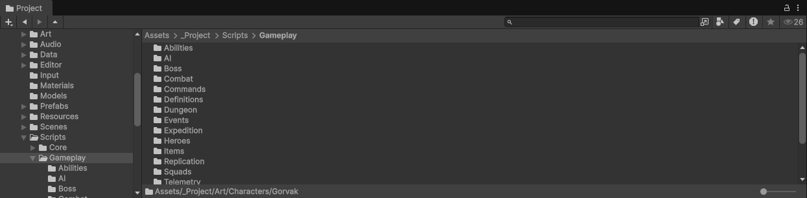
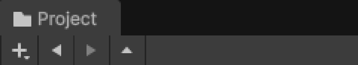
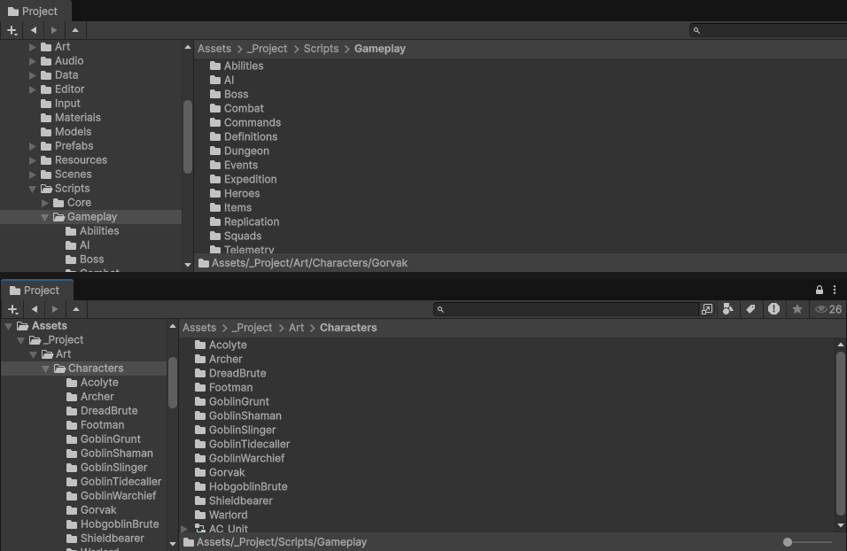

# Backtrack: Back, Forward and Up for the Unity Project window

[](https://unity.com/releases/editor/archive)
[](#installation)
[](LICENSE.md)

**Back**, **Forward** and **Up** navigation for the Unity Editor **Project window**, just like in a web browser or file explorer. Open a folder, dive three levels deep, then click Back (or press your mouse's back button) and land exactly where you were, with the same scroll position and the same assets selected. The buttons sit in the Project window's own toolbar, next to the Create (+) button, so they look like part of Unity.



## Features

- **Back, Forward and Up buttons in the toolbar.** Native toolbar style, right next to the Create (+) dropdown. Each greys out when there is nowhere to go.
- **Mouse side buttons.** The back and forward thumb buttons on your mouse work over any Project window, like in every browser.
- **Keyboard shortcuts.** Alt+Left, Alt+Right and Alt+Up, rebindable in Unity's Shortcut Manager.
- **Lands exactly where you left.** Back and Forward restore the scroll position and the selection you had in that folder. Up opens the parent folder with the folder you came from selected and scrolled into view.
- **History dropdown.** Right click Back or Forward to see every remembered folder, newest first, and jump straight to one.
- **One history per Project window.** With two or more Project windows open, each keeps its own trail. Locked Project windows work too.
- **Survives domain reloads.** Recompiling scripts or entering Play Mode does not wipe the history.
- **Safe with renames.** Folders are remembered by GUID, so renamed or moved folders stay in the history. Deleted folders are skipped.
- **Configurable.** Remembers 10 folders by default, adjustable from 1 to 100. Mouse buttons and selection restore can be switched off.
- **Zero footprint.** Lives in an editor assembly only. Nothing goes into your builds, scenes or assets, and there's nothing to set up.



## Installation

### Package Manager (git URL)

1. Open **Window > Package Manager**.
2. Click **+** > **Install package from git URL...**
3. Paste:

```
https://github.com/razzorblade/unity-project-window-navigation.git
```

To pin a specific version, add a release tag:

```
https://github.com/razzorblade/unity-project-window-navigation.git#v1.1.0
```

### manifest.json

Alternatively, add the dependency to `Packages/manifest.json`:

```json
{
  "dependencies": {
    "com.nyvion.backtrack": "https://github.com/razzorblade/unity-project-window-navigation.git#v1.1.0"
  }
}
```

Git packages require [Git](https://git-scm.com/) on your PATH.

## Usage

| Action | Result |
| --- | --- |
| Open folders as usual (folder tree, double click, breadcrumbs, ping) | Each folder you open is added to the history |
| **Back** button, mouse back button, or **Alt+Left** | Return to the previous folder, scrolled and selected as you left it |
| **Forward** button, mouse forward button, or **Alt+Right** | Go forward again after going back |
| **Up** button or **Alt+Up** | Open the parent folder, with the folder you came from selected |
| Right click **Back** or **Forward** | Pick any folder from the history |
| Open a new folder after going back | Forward history is dropped, like in a browser |

Search results are not recorded, only folders you actually open.

The mouse buttons work wherever the pointer is over a Project window, focused or not. The keyboard shortcuts act on the Project window that has keyboard focus, and step aside while you type in a text field (renaming an asset, the search box), so Alt+arrows keep working there.

### Multiple Project windows

Every Project window has its own independent history.



## Settings

**Edit > Preferences > Nyvion > Backtrack** (**Unity > Settings** on macOS)

| Setting | Default | Description |
| --- | --- | --- |
| Folders Remembered | 10 | How many folders Back can return to (1 to 100). |
| Mouse Side Buttons | On | Mouse buttons 4 and 5 go Back and Forward over a Project window. |
| Restore Selection | On | Back and Forward reselect what you had selected in that folder. Up selects the folder you came from. Scroll position is always restored. |
| Keyboard Shortcuts... | | Opens Unity's Shortcut Manager, where the **Backtrack** category holds Back, Forward and Up. |
| Clear History | | Forgets the history of every Project window. |

Settings are stored per user in EditorPrefs, so they never touch your project files or version control.

## Compatibility

- **Unity 6 (6000.0) or newer.** Developed and tested on Unity 6.3 LTS.
- Tested on the Windows editor. Nothing in the code is tied to a platform, so macOS and Linux should work too.
- Works with the Project window's **Two Column Layout**. In One Column Layout there is no "open folder", so the buttons hide.
- The buttons also hide while the Project window is very narrow (under about 370 px), where they would overlap the search field.

## How it works

Unity has no public API for the Project window toolbar, so Backtrack adds a small UI Toolkit element to each Project window's `rootVisualElement`. That layer draws above the window's own IMGUI toolbar. A lightweight poll, ten times a second, reads each window's open folder and scroll position through cached delegates and compiled accessors, and records changes. Selection is tracked from Unity's selection change event. History is kept in a `ScriptableSingleton`, which Unity carries across domain reloads.

The mouse thumb buttons are caught on each Project window's UI Toolkit panel, so they work anywhere over the window. The keyboard shortcuts are regular Shortcut Manager entries bound to a custom shortcut context that is active only while a Project window has focus.

Backtrack has to read a few internal members of Unity's `ProjectBrowser`. All of that access lives in a single class, `ProjectBrowserBridge`. If a future Unity version renames the core members, Backtrack logs one warning and switches itself off instead of throwing errors. The extras (scroll restore, scrolling to the folder on Up) switch off on their own if their members go missing, and the rest keeps working.

## FAQ

**Doesn't Unity already have selection history?**
Unity's Previous / Next Selection (Ctrl+Shift+[ and ]) steps through every *selection* you made: assets, GameObjects and folders mixed together. Backtrack only tracks the folders you *open* in each Project window, which is what you want when browsing a large project.

**Does it persist after restarting Unity?**
No. History lasts for the editor session and survives domain reloads, but starts fresh when Unity restarts. The settings are permanent.

**Alt+Left does nothing in my setup.**
Another tool may already use that key. Open **Edit > Shortcuts**, look for conflicts in the **Backtrack** category, and rebind as you like.

**Does it change my project?**
No. It creates no assets and writes nothing to your project. Remove the package and nothing is left behind.

## Uninstall

Remove the package in **Window > Package Manager**, or delete the `com.nyvion.backtrack` line from `Packages/manifest.json`.

## License

[MIT](LICENSE.md) (c) Nyvion
